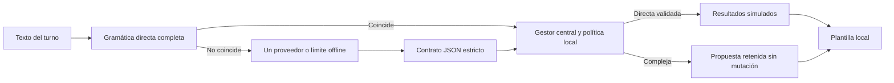

# Jarvis Next — contratos y límites de la base v1

Estado: primera etapa de 3.2, prototipo textual. La voz del residente sigue en 3.1; no hay dos motores obligatorios por turno. Next se ejecuta aparte y no importa `jarvis.intelligence`, audio, ONNX ni un cliente de red. Conservar esos módulos temporalmente no los convierte en dependencia del nuevo motor. Ver [auditoría y alcance](phase_3_2_stage_1.md).

## Flujo pequeño



La ruta directa admite: `Abre Steam/Spotify/Chrome/Discord`, `Volumen al N%` (entero 0–100), `Pausa la música`, `Silencia el audio`, `Consulta el volumen`, `Cancela`, `Olvida todo lo anterior`, `Todavía no hagas nada` y `No canceles`/`No quiero cancelar`. Acepta mayúsculas, espacios, acentos y un punto final. Conserva preguntas, comillas y cláusulas: no extrae una orden positiva de un texto más largo. No hay alias acústicos ni lista global de palabras admitidas.

Una petición natural o contextual va a un único `InterpretationProvider`. Por defecto `OfflineProvider` informa indisponibilidad, sin conexiones. `FakeProvider` es una dependencia explícita para pruebas; no una opción que finja inteligencia en la CLI. No se elige todavía Groq, Gemini ni Ollama, ni se leen claves de entorno. No hay cuotas ni resultados remotos medidos en esta etapa.

## Interfaces implementadas

| Límite | Contrato / responsabilidad |
| --- | --- |
| Entrada | `NextEngine.begin_session(id)` e `interpret(text, session_id, turn_id)`; texto 1–1600 caracteres. No acepta audio ni archivos. |
| Proveedor | `interpret(InterpretationRequest, RequestControl) -> ProviderReply`; `capabilities`; `close()`. La respuesta contiene únicamente JSON de decisión y uso de tokens opcional. |
| Solicitud | Texto actual, IDs locales, copia del plan/revisión y catálogo mínimo de cinco capacidades. Sin historial conversacional, credenciales, pantalla o estado físico inventado. |
| Decisión v1 | Operación explícita, identidad/revisión esperada del plan, alcance temporal, evidencias por rangos, llamadas, modificaciones y referencias a IDs locales. Es datos no confiables, no un permiso. [Esquema JSON](next_decision.schema.json). |
| Gestor | Emite tickets locales, aplica políticas y confirma estado bajo un lock. Los proveedores nunca modifican el estado definitivo. |
| Herramienta | Registro con ID, objetivos configurados, esquema tipado de parámetros, recurso, lectura/escritura, riesgo y disponibilidad solo simulada. Agregar definiciones no exige cambiar el tipo universal de decisión. |
| Resultado | Solo `simulated` o `unknown`, siempre `executed=false`, `verified=false`. La consulta de volumen devuelve desconocido: un valor propuesto no es una lectura. |
| Salida | `Outcome` liga solicitud/sesión/turno/generación, decisión, copia coherente del plan, resultados, código de error y duración local. La futura voz debe comprobar `manager.can_publish(outcome)` antes de sintetizar. |

Pydantic ya existía; la extra `next` permite instalar esta entrada sin la extra `intelligence` que incluye ONNX/tokenizers/huggingface-hub. Las dependencias base del paquete residente siguen instalándose; no se ha extraído una distribución nueva ni retirado bibliotecas necesarias para el residente antiguo.

## Estado y autorización

Hay una sesión temporal, una revisión monotónica, hasta ocho elementos de plan y IDs generados por el gestor. El estado está solo en RAM, caduca a los 120 s por defecto y se descarta al cambiar sesión o cerrar. Las instantáneas y resultados son copias profundas. No hay acciones pasadas ejecutables, estados observados, preferencias persistentes ni confirmaciones físicas reutilizables.

Están aplicadas centralmente: creación de una nueva propuesta directa (sustituye el plan anterior), cancelación completa, retención, consulta simulada y negación de cancelación. Cancelar vacía los elementos e incrementa la revisión sin depender de mutaciones hechas por el intérprete. Retener conserva IDs y contenido, aumenta la revisión y no habilita reanudación automática. Una orden directa nueva constituye una solicitud nueva, no una reanudación implícita.

El esquema diferencia append/modify/replace/remove/cancel_subset/answer_clarification/query/preference/deferred/conversation/negated/hypothetical/unsupported. **La aplicación contextual de esas operaciones no está completa.** Los cambios pueden combinar referencias a acciones existentes y nuevas llamadas; sus IDs y parámetros se comprueban, pero las decisiones complejas quedan retenidas sin mutación ni resultado. Aún no hay pregunta pendiente operativa, escenas ni resolución de «como antes».

La política comprueba revisión e identidad exactas, herramientas, objetivos registrados, tipos/rangos, dependencias existentes y límites de evidencias. Para autorizar simulación directa reconstruye la decisión completa desde el texto, independientemente de la ruta declarada. No confía en JSON válido, spans aportados por el modelo, risk labels ni texto libre. No toma una acción mencionada como autorización. Los objetivos del catálogo son configuración de simulación, no dispositivos descubiertos.

La semántica compleja aún no está autorizada: no se ha resuelto el problema general de validar lenguaje natural. No se afirma comprensión superior al 95% ni se presenta la gramática mínima como solución permanente de autorización. El siguiente bloque debe ampliar esa política con evidencia y pruebas antes de aceptar planes del modelo.

## Plazos, errores y cancelación

Una llamada de proveedor bajo demanda, sin polling de red ni reintentos/fallbacks en cadena. Plazo predeterminado 3 s, configurable entre 0,01 y 30 s. Un hilo daemon y un único slot por motor permiten devolver control aunque un proveedor ignore cancelación. El slot permanece ocupado hasta que termine: solicitudes siguientes reciben `busy`; las directas siguen disponibles. No se pueden matar hilos Python: el futuro adaptador HTTP deberá respetar el plazo y la cancelación para liberar sus recursos. No se promete interrumpir una biblioteca remota arbitraria.

Se descartan respuestas al cambiar turno, sesión, revisión, caducar contexto, cancelar o cerrar. Los resultados obsoletos no producen mensaje para TTS. Los resultados coherentes conservan su propia instantánea; una respuesta anterior deja de ser publicable al empezar un turno nuevo. La cancelación de interfaz usa `engine.cancel`, la misma operación central de la cancelación textual. La voz todavía no está conectada a este contrato.

Errores normalizados: indisponibilidad, conexión, autenticación, cuota, modelo ausente, timeout, respuesta inválida, cancelación, obsolescencia, ocupado, suspendido o cerrado. No se interpolan excepciones SDK, cuerpos HTTP, cabeceras ni claves en resultados o registros. Tras tres fallos consecutivos se suspende el proveedor durante 15 s; las órdenes locales no se suspenden. No existe cambio automático a un servicio de pago.

## Respuestas y recursos

No hay campo de respuesta libre del proveedor. Las confirmaciones salen de plantillas y resultados locales: «En simulación, ajustaría el volumen al 30%.» Nunca «ya lo cambié». Esta etapa tampoco genera explicaciones conversacionales mediante el proveedor falso.

Importar o crear el motor no arranca hilos, conexiones o modelos. El hilo de interpretación aparece solo cuando hay una petición no directa. No se ha cambiado el residente ni se ha medido su nuevo reposo, STT, TTS o FPS; las cifras de 3.1 siguen siendo únicamente referencia histórica.

## Migración, ejecución y restauración

```powershell
# En un entorno del proyecto, sin instalar modelos de inteligencia:
python -m pip install -e ".[dev,next]"
python -m jarvis.next "Abre Steam" "Volumen al 30%" "Olvida todo lo anterior"
python -m jarvis.next "Abre Steam, pero no todavía; cuando termine la descarga"
python -m pytest -q tests/test_next_foundation.py
```

En este equipo usar `.\.venv\Scripts\python.exe`; el entorno existente ya contiene Pydantic y pytest. Cada argumento es un turno de la misma sesión efímera. Se imprime JSON con simulación/retención/error explícitos; no se captura micrófono ni cambia configuración personal. `python -m jarvis` sigue siendo el residente 3.1. No habilitar la apertura real de aplicaciones para probar el nombre `applications.open`.

Para inspeccionar la referencia sin perder cambios: `git show phase-3-1-restore:README.md`. Para volver al checkout antiguo, conservar/confirmar primero cualquier trabajo local y cambiar a `phase-3-1-hardening`; no ejecutar reset destructivo ni force-push. El tag y la rama apuntan a `5337b86`.

El siguiente bloque recomendado es un piloto textual Groq de alcance acotado y optativo: documentación oficial vigente, selección de modelo/cuota, clave local sin registros, un adaptador y pruebas HTTP falsas; después política/contexto para un plan pequeño. No enviar audio. Si se eligen API o modelos concretos se documentarán configuración y resultados realmente medidos. Integrar voz y preparar volumen físico serán bloques posteriores; habilitar una acción física requerirá la aprobación explícita indicada por el usuario.
